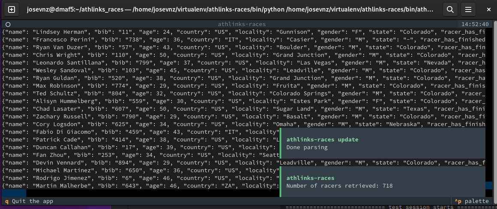

# race-crawler: web scraper for race results hosted on Athlinks and ChronoTrack

[](https://pypi.org/project/athlinks-races/)
[](https://badge.fury.io/py/athlinks-races)

[](https://pepy.tech/project/athlinks-races)



## Introduction


`athlinks` provides the [`RaceSpider`](src/athlinks/spiders/race.py) class.

This spider crawls through all results pages from a race hosted on athlinks.com,
building and following links to each athlete's individual results page, where it
collects their split data. It also collects some metadata about the race itself.

By default, the spider returns one race metadata object (`RaceItem`), and one `AthleteItem` per participant.

Each `AthleteItem` consists of some basic athlete info and a list of `RaceSplitItem` containing data from each 
split they recorded.

`race-crawler` is a race results crawler that supports more than one timing provider:

- **Athlinks** (`athlinks` package, `athlinks_races_cli` command): races hosted on athlinks.com.
- **ChronoTrack** (`chronotrack` package, `chronotrack_races_cli` command): ChronoTrack race results.

The project was previously named `athlinks-races`. The PyPI package is still published as `athlinks-races`.

## How to use this package

### Using uv

If you have installed [uv](https://docs.astral.sh/uv/), is as simple as this:

```shell
uvx --from athlinks-races athlinks_races_cli --tui --race_url https://www.athlinks.com/event/382111/results/Event/1093108/Results
```

### python scripts

Scrapy can be operated entirely from python scripts.
[See the scrapy documentation for more info.](https://docs.scrapy.org/en/latest/topics/practices.html#run-scrapy-from-a-script)

#### Installation

The package is available on [PyPi](https://pypi.org/project/athlinks-races). In your own [uv](https://docs.astral.sh/uv/) project:

```sh
uv add athlinks-races
```

Or, inside an existing virtual environment:

```sh
uv pip install athlinks-races
```

#### Example usage

[A demo script is included in this repo](src/athlinks/demo.py). It has plenty of features but is also monolithic on purpose.

```python
"""
Demonstrate the available classes.
You can run as `uv run python -m athlinks.demo`
"""
from scrapy.crawler import CrawlerProcess
from athlinks import RaceSpider, AthleteItem, RaceItem


def main():
    # Make settings for two separate output files: one for athlete data,
    # one for race metadata.
    settings = {
        'FEEDS': {
            # Athlete data. Inside this file will be a list of dicts containing
            # data about each athlete's race and splits.
            'athletes.json': {
                'format': 'json',
                'overwrite': True,
                'item_classes': [AthleteItem],
            },
            # Race metadata. Inside this file will be a list with a single dict
            # containing info about the race itself.
            'metadata.json': {
                'format': 'json',
                'overwrite': True,
                'item_classes': [RaceItem],
            },
        }
    }
    process = CrawlerProcess(settings=settings)

    # Crawl results for the 2022 Leadville Trail 100 Run
    process.crawl(RaceSpider, 'https://www.athlinks.com/event/33913/results/Event/1018673/')
    process.start()


if __name__ == "__main__":
    main()
```

If you clone this repo and run `uv sync --all-groups` then you can run as

```shell
uv run athlinks_races_cli
```

Then you can build the distributions (sdist and wheel) to install locally if needed:

```shell
uv build
```

### Command line

Alternatively, you may clone this repo for use like a typical Scrapy project
that you might create on your own.

#### Installation

```sh
git clone https://github.com/josevnz/races-crawler
cd races-crawler
uv sync --all-groups
```

`uv sync` creates the virtual environment in `.venv` and installs the Python version pinned in
`.python-version` (3.14) if it is not already available.

#### Example usage

Run a `RaceSpider`, few races with different years:

```shell
cd races-crawler
uv run scrapy crawl race -a url=https://www.athlinks.com/event/33913/results/Event/1018673 -O $HOME/1018673.json
uv run scrapy crawl race -a url=https://www.athlinks.com/event/382111/results/Event/1093108 -O $HOME/1093108.json
uv run scrapy crawl race -a url=https://www.athlinks.com/event/382111/results/Event/1062909 -O $HOME/1093108.json
```

Or the newer `athlinks_races_cli`, with the `--tui` argument:

```shell
(race-crawler) [josevnz@dmaf5 race-crawler]$ uv run athlinks_races_cli --tui
2025-01-12 14:56:31 [scrapy.middleware] INFO: Enabled item pipelines:
[]
2025-01-12 14:56:31 [scrapy.core.engine] INFO: Spider opened
2025-01-12 14:56:31 [scrapy.extensions.logstats] INFO: Crawled 0 pages (at 0 pages/min), scraped 0 items (at 0 items/min)
2025-01-12 14:56:31 [scrapy.extensions.telnet] INFO: Telnet console listening on 127.0.0.1:6023
2025-01-12 14:56:31 [asyncio] DEBUG: Using selector: EpollSelector

```

## Dependencies

All that is required is [Scrapy](https://scrapy.org/) and [Textual](https://github.com/Textualize/textual) (and its dependencies).

## Testing

```shell
uv run pytest tests/test_athlinks.py
```

Example session:

```shell
(race-crawler) [josevnz@dmaf5 race-crawler]$ uv run pytest /home/josevnz/race-crawler/tests/test_athlinks.py
============================================================= test session starts =============================================================
platform linux -- Python 3.11.6, pytest-8.3.3, pluggy-1.5.0
rootdir: /home/josevnz/race-crawler
configfile: pyproject.toml
collected 6 items                                                                                                                             

tests/test_athlinks.py ......                                                                                                                   [100%]

============================================================== 6 passed in 0.33s ==============================================================

```

## License

This project is licensed under the MIT License. See [LICENSE](LICENSE) file for details.

## Contact

You can get in touch with me here:

- GitHub: [https://github.com/josevnz](https://github.com/josevnz)

### Original Author

If you want to take a look at the original project. He is not in charge of this forked version.

- GitHub: [github.com/aaron-schroeder](https://github.com/aaron-schroeder)
